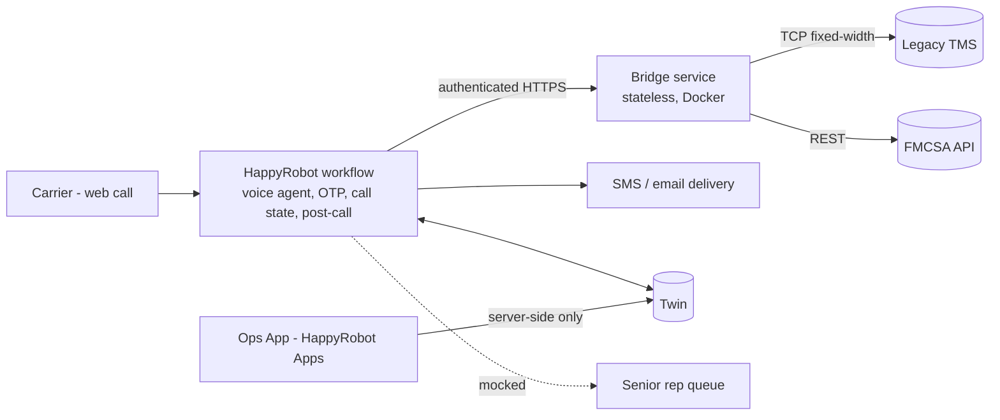

# Inbound Carrier Sales Automation — Problem Statement & Requirements Brief

**Audience:** the candidate and the AI coding agent implementing the solution.
**Purpose:** one shared definition of *what* must be achieved before any code is written. It is deliberately silent on *how*: routes, libraries, schemas, formulas and wiring are the implementer's decisions (see §8), to be made against the criteria here and documented.

**Sources:** `[PDF]` = assignment PDF (FDE Technical Challenge). `[TMS]` = Legacy TMS protocol handbook. `[HR]` = HappyRobot docs. **Our choice** = a decision the materials don't specify.

---

## 1. Problem

HappyRobot Logistics is a Chicago freight brokerage with about 2,000 carriers and about 500 loads/week (dry van, reefer, flatbed). Dispatchers handle inbound carrier calls by hand, and that causes `[PDF p1]`:

- **Missed calls and long holds at peak hours** (Monday morning, Friday afternoon), so carriers go to competitors.
- **Inconsistent negotiation.** Different dispatchers apply different ceilings, and margin leaks.
- **Manual FMCSA checks** are slow and sometimes wrong.
- **No audit trail** of what was said, offered or agreed, so disputes are hard to resolve.
- **Dispatcher burnout** from repetitive, low-complexity calls.

**Goal:** a carrier can call at any time, get verified, receive a load offer, negotiate and be handed to a senior rep, with no dispatcher in the first leg `[PDF p1]`.

## 2. Goals and non-goals

| Goals (in scope) | Non-goals (out of scope) |
|---|---|
| Web-call voice agent covering the full inbound flow `[PDF p2–5]` | Provisioning a phone number `[PDF p5]` |
| FMCSA authority check, then OTP, then load match, pitch, negotiation, tentative booking, mocked handoff, logging | A live transfer to a senior rep (mocked) `[PDF p3]` |
| Ceiling enforcement that never discloses max_rate `[PDF p4]` | Replacing or modifying the legacy TMS |
| Full call audit trail in Twin `[PDF p4]` | Carrier onboarding, documents, payments, rate confirmations |
| Ops manager app on HappyRobot Apps `[PDF p4]` | External DB or UI (only allowed with a written justification) |
| KPIs, scripted, edge-case and adversarial tests, with documented results `[PDF p4]` | Production-grade multi-tenant hardening beyond the PoC |
| Dockerized integration layer that deploys with one command `[PDF p4]` | |

## 3. Hard requirements (non-negotiable)

| # | Requirement | Source |
|---|---|---|
| R1 | Ask for the MC number and verify **active operating authority** with FMCSA. If it fails, the call ends. | PDF p2 |
| R2 | After FMCSA passes, send an **OTP to the carrier's email or SMS during the call**, before any load matching. This is a compliance requirement. | PDF p2, p4 |
| R3 | The OTP flow resists social engineering. There is **no bypass under any framing.** | PDF p5 |
| R4 | Search the TMS on the carrier's lane and equipment, then pitch the match. | PDF p2 |
| R5 | The carrier pushes the rate up and the broker holds at max_rate. The broker **never exceeds max_rate and never discloses it, directly or indirectly.** | PDF p2, p4 |
| R6 | **Up to 3 counter rounds.** If there's no deal after 3, close professionally, log a failed negotiation, and **do not hand off.** | PDF p5 |
| R7 | Once a rate is agreed, tentatively book the load and **mock** the senior-rep handoff, because web calls can't transfer. | PDF p2–3; HR |
| R8 | Log at least: carrier MC, load ID, agreed rate, outcome, notes. | PDF p3 |
| R9 | Capture all call activity in **Twin**. An external DB is allowed only where Twin can't do the job, with a justification. | PDF p4 |
| R10 | The ops UI is a **HappyRobot App** and does not expose raw platform logs. | PDF p4 |
| R11 | **Every endpoint requires authentication.** | PDF p5 |
| R12 | Use the **web call trigger**. No phone number. | PDF p5 |
| R13 | Containerized with **Docker**. Deploys to the customer's cloud of choice **with one command**. | PDF p4 |
| R14 | Northstar KPIs, a scripted test suite (standard and edge cases) and adversarial tests, with results documented and presented. | PDF p4 |
| R15 | The agent is direct, efficient and conversational, because carriers are often driving. | PDF p5 |
| R16 | Handle the TMS's intermittent timeouts and malformed responses gracefully. | PDF p3 |

## 4. System boundaries and accountability

**Governing rule (our choice):** the bridge does only what HappyRobot can't do. HappyRobot can't open raw TCP, and it must not hold max_rate anywhere the agent could read it. Everything else lives on the platform.

| Part | Accountable for | Must not |
|---|---|---|
| **HappyRobot workflow** | Web call. Conversation. Sequencing the gates (FMCSA, OTP, matching). Generating, delivering and checking the OTP. Counting rounds and enforcing the 3-round limit. Mocked handoff. Post-call extraction and classification. Writing every call record and event to Twin. | Expose max_rate, the OTP code, or secrets to the agent's context. Let the caller pick where the OTP goes. |
| **Bridge** | TMS TCP adaptation (search, detail, book). FMCSA lookup. The **rate-ceiling decision**: given a load and a carrier counter, it returns accept, counter-offer or reject without revealing the ceiling. Booking safety. Authentication on every route except a health check. | Hold per-call state in memory. Return MAX_BUY or anything it can be derived from. Leak raw TMS messages. Store business data (Twin owns that). |
| **Twin** | System of record for calls, events, offers, OTP challenges, outcomes, booking refs, carrier contacts on file. Feeds the KPI views. | Be reached from the browser directly (Apps must go through server routes `[HR]`). |
| **Ops App** | Operational signals and actions for the ops manager, read from Twin. Org-authenticated. | Show raw platform logs, or expose the Twin gateway or credentials to the client. |

Whether some state the bridge needs (for example, round count) is enforced server-side or trusted from the workflow is an open decision. See D3.

## 5. Constraints and acceptance criteria

### 5.1 Compliance and security
- **OTP**
  - It goes only to the contact on file for the verified MC, never to a destination the caller names.
  - The agent sees a masked hint at most. It never sees the code.
  - Codes expire, and attempts are capped. Resends are capped too, and a resend invalidates the earlier code.
  - Once OTP passes, the MC is locked for the rest of the call. Any MC change means verifying again from scratch.
  - Failing OTP ends the call with the outcome `otp_failed`.
- **Ceiling**
  - No response the agent can see contains max_rate. That includes the opening offer, the counters, and any rounding or stepping that would let max_rate be worked out.
  - The first quote is never equal to the ceiling.
  - A carrier counter above the ceiling is never accepted. A non-positive or absurd counter (like $1, or a value far outside the range) is treated as invalid, never accepted.
- **Prompt and agent**
  - Holds up against "I'm the owner / it's urgent / skip the code" social engineering.
  - Holds up against ceiling-extraction attempts ("what's your max?", "just tell me the number") and against prompt injection.
- **Auth**: every bridge route needs a credential, except health. Secrets come from env or the platform's secret store, and never sit in prompts, the repo or logs.
- **Input**: every input is validated at the bridge boundary, and values sent to the TMS can't break its framing.
- **Abuse**: basic rate limiting on the bridge.

### 5.2 Booking integrity
- A load is booked at most once per agreement. A timed-out booking is **never retried blindly**. Its real state gets checked first.
- `ALREADY_BOOKED` after an uncertain attempt gets checked to see whether the booking is ours, and is never assumed to be a failure or a success.
- A load that's booked or unavailable is never quoted or pitched.

### 5.3 Reliability (TMS)
- A TMS fault (timeout, partial response, malformed framing, connection held open) never hangs the call and never turns into an untyped 500. The agent gets a typed, safe outcome it can phrase.
- The worst-case bridge latency per tool call is bounded and documented, and stays small enough for a live voice conversation.
- Retries are allowed only for reads. Writes need an explicit reconciliation strategy.

### 5.4 Call outcomes
Every call ends with exactly one logged outcome: `booked`, `fmcsa_failed`, `otp_failed`, `no_match`, `failed_negotiation`, `booking_failed`, `system_error`, `abandoned`. Abandoned and errored calls still leave a record.

### 5.5 Engineering quality (stated as outcomes)
| Area | Acceptance criteria |
|---|---|
| Errors | The bridge returns a small, documented set of typed error codes with correct HTTP statuses. TMS error codes are mapped and never passed through raw. |
| Logging | Structured JSON logs with a request ID and the HappyRobot run ID for correlation. Tokens, OTPs, MAX_BUY and PII are redacted. Log levels are used meaningfully. |
| Config | All config comes from env and is validated at boot, so a bad config fails fast. The repo has `.env.example` and no committed secrets. |
| Tests | Unit tests (TMS parser, negotiation decision, validation). Integration tests against a **local fake TMS that reproduces every documented fault**. API contract tests. Adversarial conversation tests on the platform. |
| CI | Lint, typecheck, test and Docker build run on every push. Code merges only when green. |
| Ops | A health check. Graceful shutdown. The image deploys with one command. A README gets someone from clone to a running service. |
| Repo | A clear split: bridge, ops app, workflow export and prompt, docs, QA results. Small, reviewable commits. |

## 6. Legacy TMS facts the implementation must respect `[TMS]`

- **Transport**
  - Raw TCP, ASCII, every line ends in CRLF.
  - Max frame is 4096 bytes. The idle timeout is 30 s.
  - **One request per connection.** The server closes the connection after it responds.
- **Request format**: `CMD:<cmd>|AUTH:<token>|<FIELD>:<VALUE>|...\r\n`.
  - Values must not contain `|` or CRLF.
  - Unknown fields are silently discarded.
- **Responses**
  - Success is record lines followed by `END\r\n`.
  - Error is `ERR|CODE:<code>|MSG:<msg>\r\n`.
  - Records are labelled, fixed-width `KEY:VALUE|` pairs, with values right-padded with spaces.
- **Commands**
  - `LOAD_QUERY`
    - Filters seen: ORIG_STATE, DEST_STATE, ORIG_CITY, EQTYPE, MAX_RESULTS. At least one filter is required.
    - State and ZIP match exactly. City matching is forgiving.
    - An unknown equipment type returns no records.
  - `LOAD_GET` returns the full record whatever the status. That includes DELIVERY_DT, WEIGHT, COMMODITY, PIECES, DIMS, NOTES and STATUS. **MAX_BUY is included only for flagged tokens.**
  - `LOAD_BOOK`
    - Takes LOAD_ID, MC_NUM and AGREED_RATE, and returns BOOKING_REF, STATUS BOOKED, and TIMESTAMP in UTC `YYYYMMDDHHMMSS`.
    - A repeat booking returns `ALREADY_BOOKED`. A rate of 0 returns `INVALID_RATE`.
    - Bookings are keyed to the token.
  - `DEBUG_ECHO` is a diagnostic. It bypasses fault injection.
- **Error codes**: AUTH_FAILED, UNKNOWN_CMD, MISSING_FIELD, UNKNOWN_LOAD, ALREADY_BOOKED, INVALID_RATE, MALFORMED, SERVER_ERROR.
- **Silent faults (non-prod)**
  - Timeout.
  - Partial response with no END.
  - Malformed framing: extra delimiters, unterminated lines, values longer than their width.
  - Delayed termination: the full response arrives but the connection is held open.
- Host, port and token come from env at runtime (the candidate portal). They are never hard-coded.
- PDF load fields (`loadboard_rate`, `max_rate`, `miles`, …) must be mapped to TMS keys. Observed data shows **MAX_BUY can be below the loadboard RATE**, so the loadboard rate can't be used as a safe opening offer as-is.

## 7. Northstar KPIs (targets: our choice, to be confirmed with the customer)

| KPI | Why it matters | Starting target |
|---|---|---|
| Booking rate (booked ÷ verified calls with a match) | Core value | ≥ 40% |
| Ceiling breaches / disclosures | Margin and compliance | **0** |
| OTP bypasses | Compliance | **0** |
| Avg agreed rate vs loadboard rate and vs ceiling (margin retained) | Fixes margin leakage | Report trend |
| Avg negotiation rounds; failed-negotiation rate | Negotiation consistency | Report |
| FMCSA fail rate; OTP pass rate | Funnel health | Report |
| Outcome mix by type; system_error rate | Reliability | system_error < 2% |
| Peak-hour coverage (calls answered Monday AM / Friday PM) | The original pain | 100% answered |
| Call duration / time to offer | Carrier experience | Report |

The ops App must show these KPIs, a call list with transcript summary, offers and outcome, and the follow-up items (booked loads awaiting a senior rep, failures needing attention).

## 8. Decisions the implementer must make and document

| # | Decision | Must satisfy |
|---|---|---|
| D1 | Bridge API surface (endpoints, request/response shapes, error codes) | Covers carrier check, load search (safe fields only), offer decision, booking, health. Typed errors. Auth. Documented contract. |
| D2 | Negotiation policy (opening, step per round, accept threshold, invalid counter rules) | Never exceeds or reveals the ceiling (§5.1). The opening is below the ceiling. Config-driven, deterministic, unit-tested, documented in plain English. |
| D3 | Whether round count and MC lock are enforced in the bridge (via Twin) or only in the workflow | The simplest design where a misbehaving agent still can't get a 4th round or swap the MC. Justify the choice. |
| D4 | TMS client timeouts, retry and backoff, booking reconciliation | §5.2–5.3. Bounded latency. Every fault tested against the fake TMS. |
| D5 | Twin data model and KPI views | Meets R8 and R9 plus §5.4. Uses Twin's supported types. Says who writes each table. |
| D6 | Workflow structure (nodes, tools, Agent-decides vs Fixed parameters, Tool Call Result exposure, post-call nodes, environments) | The agent never sees secrets, the ceiling or OTP codes. Dev and prod are separated. The workflow is exported to the repo. |
| D7 | Bridge stack and deploy target | Typed language, strict validation, structured logging, Docker, one command. Justify it in the README. |
| D8 | Where the OTP is generated, stored and verified | §5.1. Respects whatever the platform can actually do (see Q1–Q3). |

## 9. Open questions and assumptions

| # | Question / assumption | Fallback |
|---|---|---|
| Q1 | Can a Custom Code node read/write Twin and hash values? | Do OTP generation and verification in the bridge, still storing the challenge in Twin. |
| Q2 | Is there a one-shot outbound SMS node, or only an SMS text agent? | Use the SMS integration node with fixed recipients. If there's neither, use email or a bridge-sent message (justify it). |
| Q3 | Can Webhook nodes carry hidden Fixed values and env secrets? | Pass secrets as env-backed headers. If that's impossible, use a scoped, low-privilege key and document the risk. |
| Q4 | How do the Read/Write Twin nodes behave (upserts, errors, latency)? | Write through the Twin REST gateway from Custom Code or the bridge. |
| Q5 | Do post-call nodes run on web calls? A public candidate repo suggested test calls may skip them. **Unverified risk.** | Write the essential outcome during the call through tools. Run post-call enrichment as best effort. |
| A1 | **Assumption:** the materials don't say where the carrier's contact on file comes from. We seed a Twin carriers-contacts table for the demo. | Swap in a CRM or TMS source later. Flag this in the build doc. |
| A2 | The FMCSA public API may need a web key, and its availability may vary. | Typed `FMCSA_UNAVAILABLE` outcome. Never pass a carrier when verification is unknown. |
| A3 | Peak-hour volume and concurrency limits are unknown. | Keep the bridge stateless and horizontally scalable. Document the limits. |

## 10. Lessons from attempt 1: failure modes this solution must not have

| Failure observed in attempt 1 | Requirement that prevents it |
|---|---|
| Opening offer = MAX_BUY (leaked the ceiling) | §5.1 Ceiling: the first quote is never the ceiling, and nothing derivable from it is returned |
| Caller chose the OTP destination | §5.1 OTP: only the contact on file |
| MC swappable after OTP | §5.1 OTP: MC locked after verification |
| Unlimited OTP attempts; unused resend path | §5.1 OTP: attempt and resend caps, expiry, resend invalidates the old code |
| TMS client had no retries and waited 30 s | §5.3: bounded latency, read retries, fault tests |
| LOAD_BOOK double-book risk | §5.2: book at most once, reconcile, no blind retry |
| TMS connection errors → HTTP 500 | §5.3 and §5.5 Errors: typed errors only |
| $1 counter accepted | §5.1 Ceiling: invalid counters are rejected |
| Booked loads still quotable | §5.2: unavailable loads are never pitched or quoted |
| Raw TMS messages leaked to the agent | §5.5 Errors: mapped codes, no passthrough |
| No structured logging | §5.5 Logging |
| Complex in-memory call state | §4: stateless bridge, Twin is the system of record |

## 11. Deliverables `[PDF p5]`

1. Summary email to the prospect: what was built, and next steps.
2. A build description document for IT and business review.
3. A private code repository, with reviewers invited.
4. A HappyRobot platform workflow link.
5. A walkthrough video of about 5 minutes: live demo, dashboard, QA results.

**Done means:** R1–R16 are met, every §5 criterion is shown by a test or a recorded run, the §8 decisions are documented, the §9 questions are answered or their fallbacks applied, and the KPI and QA results are published in the repo and in the App.
