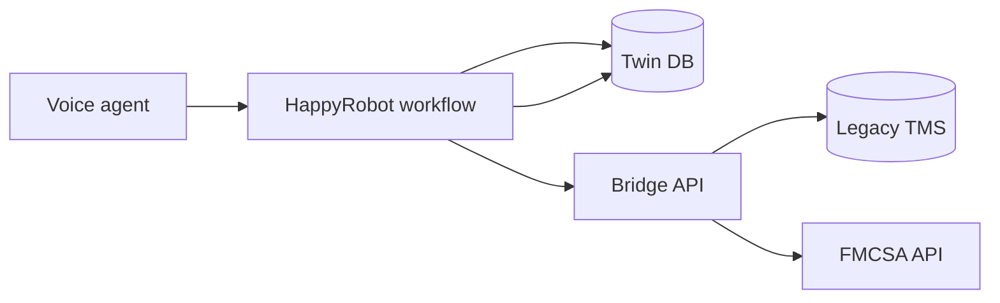

# Inbound carrier sales (HappyRobot + bridge)

Voice workflow (**Version 3**) verifies carriers (FMCSA + OTP), searches loads, negotiates rates, and books through a **stateless TypeScript bridge** on Cloud Run. Call state lives in **Twin** (Postgres); the bridge talks to **legacy TMS** (TCP) and **FMCSA** (HTTPS).

## Architecture



| Piece | Role |
| --- | --- |
| **Workflow** | Six tools: `verify_carrier`, `search_loads`, `send_otp`, `verify_otp`, `negotiate` (opening / counter / `action: accept`), `book_load`. Export: [`workflow/exports/inbound-carrier-sales-version-3.json`](workflow/exports/inbound-carrier-sales-version-3.json). |
| **Bridge** | [`bridge/`](bridge/) — Fastify, Bearer auth, no Twin credentials. Contract: [`bridge/openapi.yaml`](bridge/openapi.yaml). Design detail: [`docs/design.md`](docs/design.md). |
| **Twin** | [`docs/twin/schema.sql`](docs/twin/schema.sql), [`views.sql`](docs/twin/views.sql), [`seed.sql`](docs/twin/seed.sql). |

Requirements brief: [`docs/problem-brief.md`](docs/problem-brief.md).

## Local setup

1. Copy [`.env.example`](.env.example) → `.env` (never commit `.env`).
2. `make install`
3. Twin: run `docs/twin/schema.sql`, then `views.sql`, then `seed.sql` in the Twin SQL console.
4. Terminal 1: `make run` → `http://localhost:8080/health`
5. Terminal 2 (optional): `make tunnel` with `NGROK_DOMAIN` in `.env` for HappyRobot webhooks.

## Test & deploy

```bash
make lint typecheck test docker-build
make deploy   # Cloud Run via scripts/deploy-cloud-run.sh
```

Smoke (with `BRIDGE_API_KEY` in env):

```bash
curl -sS "$BRIDGE_BASE/health"
curl -sS -X POST "$BRIDGE_BASE/v1/carriers/verify" \
  -H "Authorization: Bearer $BRIDGE_API_KEY" -H "Content-Type: application/json" \
  -d '{"mc_number":"136818"}'
```

**Pick a live load id for tests** (direct TMS; needs `TMS_*` in `.env`):

```bash
make list-loads
make list-loads LIMIT=10 EQUIPMENT=REEFER
```

Lane search via the bridge (max **3** loads, optional `origin_state` / `dest_state`):

```bash
curl -sS -X POST "$BRIDGE_BASE/v1/loads/search" \
  -H "Authorization: Bearer $BRIDGE_API_KEY" -H "Content-Type: application/json" \
  -d '{"equipment_type":"DRY_VAN","origin_state":"AL","dest_state":"MO"}'
```

## Test carriers (FMCSA + OTP seed)

Twin seed maps these **ACTIVE** freight MCs to the email in [`docs/twin/seed.sql`](docs/twin/seed.sql) (default inbox for E2E):

| MC | Carrier | Use |
| --- | --- | --- |
| **136818** | Swift Transportation | Default happy path |
| **133655** | Schneider National | Alternate ACTIVE |
| **114457** | Dart Transit | Alternate ACTIVE |
| **150300** | Miller Transports | Alternate ACTIVE |
| **784219** | BOZHA COMPANY | `NOT_AUTHORIZED` (no active authority) |
| **999999** | — | `NOT_FOUND` |

Eligibility rule: `allowedToOperate=Y`, `oosDate` null, common or contract authority **A**. Bridge returns `FMCSA_UNAVAILABLE` on upstream errors — do not treat as ineligible.

Live load example: **`LD00983`** → opening negotiate returns **$821** when TMS is reachable.
